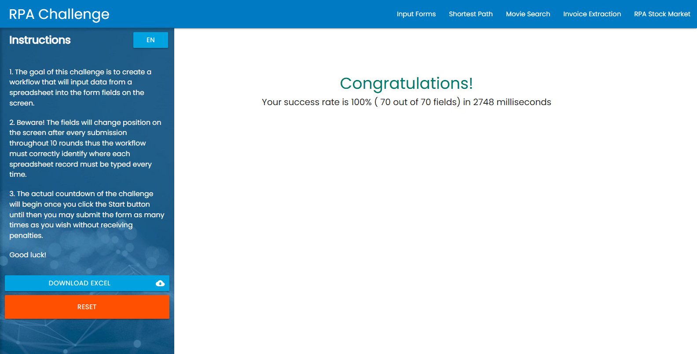

# Robô RPA Challenge · BotCity

[](https://github.com/SirDann-sys/robo-rpa-challenge/actions/workflows/robo.yml)

**▶ [Ver a última execução real](https://sirdann-sys.github.io/robo-rpa-challenge/)**: o replay, quadro a quadro, do robô rodando no GitHub Actions.

Robô em Python que resolve o [RPA Challenge](https://rpachallenge.com/), feito com o
[BotCity Framework Web](https://documentation.botcity.dev/frameworks/web/) e pronto para rodar pelo
[BotCity Maestro](https://documentation.botcity.dev/maestro/).



## O desafio

O site entrega uma planilha com 10 pessoas e um formulário com 7 campos. A cada envio **os campos trocam de lugar**,
então um robô que clica por posição erra a partir da segunda rodada.

## Como o robô resolve

1. Abre o navegador pelo `WebBot` e baixa a planilha pelo link da própria página.
2. Lê a planilha com `openpyxl`, corrigindo o que vem torto: o cabeçalho `"Last Name "` tem espaço sobrando e
   o telefone vem como número (`40716543298.0`).
3. Para cada linha, acha cada campo **pelo rótulo visível** (`//label[...]/following-sibling::input`), e não pela posição.
4. Lê a mensagem final, guarda um print e registra acerto e tempo.

Resultado: **100% (70 de 70 campos) em cerca de 3 segundos**.

## Rodar

Precisa de Python 3.10+ e Chrome (ou Edge). Tudo fica num ambiente virtual, sem mexer no Python do sistema.

```bat
python -m venv .venv
.venv\Scripts\pip install -r requirements.txt
.venv\Scripts\python bot.py
```

O driver do navegador é resolvido sozinho pelo Selenium Manager. Opções por variável de ambiente (`config.py`):

| Variável | Padrão | Para quê |
|---|---|---|
| `ROBO_HEADLESS` | `0` | `1` roda sem abrir a janela |
| `ROBO_NAVEGADOR` | `chrome` | `edge` também funciona |
| `ROBO_SAIDA` | `saida/` | planilha baixada e prints |
| `ROBO_ESPERA_MS` | `10000` | tempo máximo para achar cada elemento |
| `ROBO_GRAVAR` | `0` | `1` grava os prints e o `execucao.json` do replay |

## A demo na web é uma execução real

O workflow [`robo.yml`](.github/workflows/robo.yml) roda a cada push, todo dia às 8h (Brasília) e sob demanda:

1. instala o Python e as dependências num Ubuntu do GitHub (o Chrome já vem instalado);
2. roda os testes;
3. executa o robô sem janela com `ROBO_GRAVAR=1`, que salva um print antes de cada Submit, a ordem em que os campos
   apareceram na tela, o log e o resultado (`gravacao.py`);
4. monta a página do replay (`ferramentas/gerar_site.py` + `site/`) e publica no GitHub Pages.

Se o robô falhar, nada é publicado: a página continua com a última execução boa, o selo acima fica vermelho e os
prints do erro ficam anexados ao run.

## Pelo BotCity Maestro

`build.bat` gera `robo-rpa-challenge.zip` para o Easy Deploy. Quando o Maestro inicia a tarefa, o `Bot.main()`
do framework conecta sozinho e o robô:

- envia o print do resultado como **artefato**;
- encerra a tarefa como `SUCCESS` (100%), `PARTIALLY_COMPLETED` (algum campo errado) ou `FAILED`,
  com total, processados e falhas;
- em erro, registra a exceção com o print da tela no Maestro.

Rodando local, as mesmas etapas só aparecem no console.

## Testes

```bat
.venv\Scripts\python -m pytest -q testes
```

Os testes não abrem navegador: conferem a leitura da planilha (cabeçalho com espaço, telefone numérico, linha vazia,
coluna faltando), a leitura da mensagem de resultado e o gravador do replay.

## Estrutura

```
bot.py                  robô (WebBot): navegação, preenchimento, Maestro
desafio.py              regras sem navegador: planilha, ordem dos campos, mensagem de resultado
gravacao.py             gravação da execução para o replay
config.py               opções por variável de ambiente
site/                   página do replay (HTML, CSS e JS sem dependências)
ferramentas/gerar_site.py  junta a página com a execução gravada
.github/workflows/      execução no GitHub Actions + publicação no Pages
testes/                 pytest
build.bat               pacote para o Maestro
```
